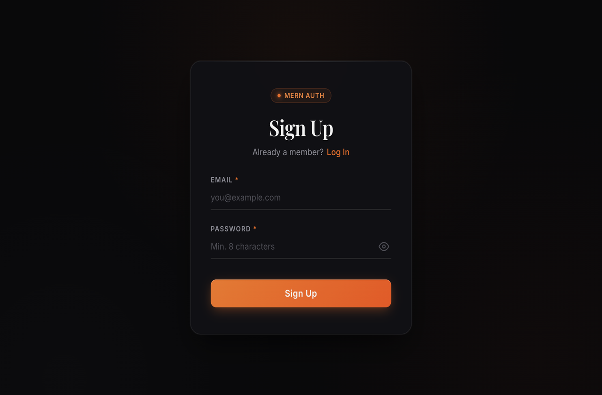
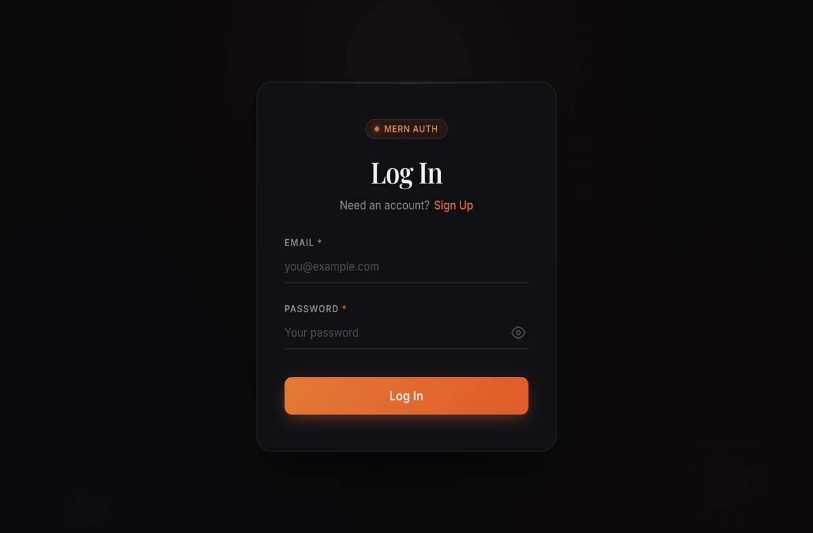
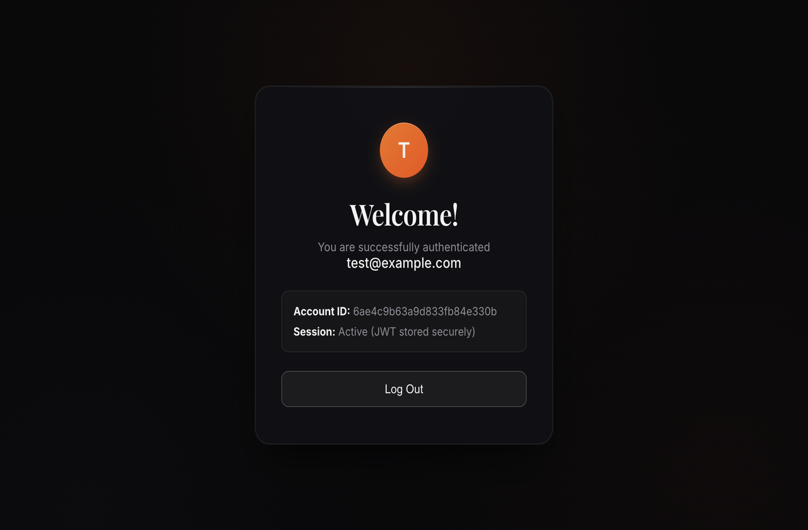

# Sign Up Application

A full-stack, secure user registration and authentication application built with **React**, **Express.js**, and **MongoDB**.

---

## 📸 Application Preview

### Sign Up Page


### Log In Page


### Authenticated Dashboard


---

## 🎨 Design Implementation

- **Brand Badge:** Sleek, modern pill badge (`● MERN AUTH`) with subtle border glow.
- **Heading:** Centered serif heading (`Playfair Display`) with high-contrast typography.
- **Sub-link:** `"Already a member? Log In"` / `"Need an account? Sign Up"` routing dynamically.
- **Underline Inputs:** Minimalist underline-only fields for Email and Password with smooth animated gradient focus bar and reactive label highlighting.
- **Primary Button:** Full-width vibrant orange gradient button with specular top highlight, smooth hover elevations, micro-animations on hover/press, and inline loading spinner state.
- **Password Visibility:** Interactive toggle inside password field with animated SVG icons and ARIA accessibility labels.
- **Ambient Aesthetic:** Subtle dark mesh background with warm ambient depth and glassmorphic card backdrop blur.

---

## 🏗 Architecture & Features

- **Frontend (Client):**
  - Built with React 18 & Vite
  - React Router v6 for navigation (`/signup`, `/login`, `/dashboard`)
  - Real-time client-side validation (email format, minimum 8 characters with letter & number)
  - Accessible forms with ARIA attributes and error announcements
  - Token-based auth context with local storage persistence and route guards
- **Backend (Server):**
  - Express.js REST API
  - Secure password hashing using `bcryptjs` with salt rounds (cost 12)
  - JWT token generation & bearer authorization middleware
  - Server-side validation using `express-validator`
  - Robust security headers with `helmet`, configured `cors`, and IP rate-limiting with `express-rate-limit`
  - MongoDB Mongoose schema with unique indexes and duplicate key conflict handling (`409 Conflict`)
  - Built-in fallback to `mongodb-memory-server` for seamless zero-setup local development

---

## 🚀 Getting Started

### Prerequisites
- Node.js (v18+ recommended)
- MongoDB running locally or MongoDB Atlas URI (or automated in-memory MongoDB fallback)

### 1. Server Setup
```bash
cd server
npm install
npm run dev
```
The server will start on port `5001` (or `PORT` specified in `.env`).

### 2. Client Setup
```bash
cd client
npm install
npm run dev
```
The client will start on `http://localhost:5173`.

---

## 📡 REST API Reference

| Method | Endpoint | Description | Status Codes |
|---|---|---|---|
| `POST` | `/api/auth/signup` | Registers new user & returns JWT | `201`, `400`, `409`, `429` |
| `POST` | `/api/auth/login` | Authenticates user & returns JWT | `200`, `400`, `401`, `429` |
| `GET` | `/api/auth/me` | Fetches authenticated user info | `200`, `401` |
| `GET` | `/api/health` | Service health check | `200` |

---

## 👤 Author

- **Abhinav Kumar** ([@Abhinav-kumar2003](https://github.com/Abhinav-kumar2003))
